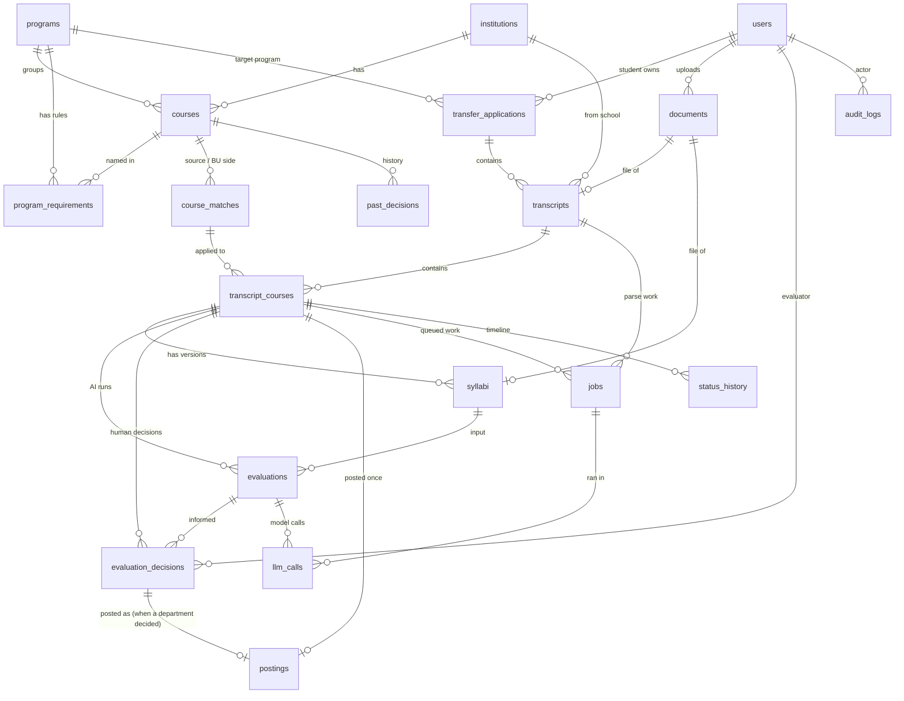

# Database design

PostgreSQL 16 with the `pgvector` extension. Files are stored in Azure Blob Storage, never in Postgres.
Models: [`app/db/models.py`](../app/db/models.py).
Generated DDL (review only): [`schema.generated.sql`](schema.generated.sql). Regenerate it with `python scripts/generate_schema_sql.py`.

## Tables (19)

| Group | Table | Purpose |
|---|---|---|
| Reference | `institutions` | BU and source schools. `calendar_type` drives the quarter x 2/3 rule |
| Reference | `programs` | Five majors, with a display summary of BU rules |
| Reference | `program_requirements` | Structured rules: required courses, non-transferable groups, max counts, residency |
| Reference | `courses` | One catalog for BU and all peer schools, with `embedding vector(384)` |
| Reference | `course_matches` | Existing source course to BU course matches, with match level |
| Reference | `past_decisions` | ~100 synthetic historical decisions for the accuracy test |
| People | `users` | Students, evaluators, credit office (synthetic) |
| Intake | `transfer_applications` | One application per student. Owns the one-year deadline |
| Intake | `documents` | Tracks uploaded files; bytes live in Blob Storage |
| Intake | `transcripts` | One transcript per source school, parse status |
| Intake | `transcript_courses` | One course line. Holds the live status the student sees |
| Intake | `syllabi` | Versioned syllabus uploads with extracted text and embedding |
| Evaluation | `evaluations` | One AI run: candidates, suggestion, evidence, provider, model |
| Evaluation | `evaluation_decisions` | Human decision with required reason. Never edited |
| Evaluation | `postings` | A snapshot of what was posted with grade T, once per course. Separate from the decision, never edited |
| Operations | `jobs` | Postgres-backed queue (swap for Service Bus later) |
| Operations | `llm_calls` | Every model call: provider, tokens, latency, fallback used |
| Operations | `status_history` | One row per status change, feeds the student timeline |
| Operations | `audit_logs` | Append-only trail of who did what |

LangGraph checkpoint tables are created by the checkpointer. They support pause and resume only; our tables stay the system of record.

## ER diagram



## Status lifecycle (`transcript_courses.status`)

```
PARSED -> MATCHED                      existing match found
PARSED -> NOT_ELIGIBLE                 failed a rule (for example grade below C)
PARSED -> AWAITING_SYLLABUS            no match, syllabus needed
AWAITING_SYLLABUS -> AI_PENDING        syllabus uploaded, job queued
AI_PENDING -> IN_REVIEW                AI suggestion ready, or no suggestion
IN_REVIEW -> PENDING_INFO              evaluator asks for more evidence
PENDING_INFO -> AI_PENDING             student replies, re-run
IN_REVIEW -> DECIDED                   evaluator decision recorded
DECIDED -> POSTED                      credit office posts grade T
MATCHED -> POSTED                      credit office posts an applied equivalency
```

Every transition writes a `status_history` row and an `audit_logs` row in the same transaction.
The database does not enforce legal transitions; the API and the LangGraph workflow do.

## Design rules

1. **AI never writes the outcome.** `evaluations` stores suggestions only. `final_outcome` and `final_credits` on `transcript_courses` are set from an `evaluation_decisions` row.
2. **Decisions are immutable.** A trigger blocks UPDATE and DELETE; a new decision supersedes the old (latest `decided_at` wins). A CHECK requires a non-empty `reason`.
3. **`audit_logs` is append-only** (trigger in [`audit_append_only.sql`](../app/db/sql/audit_append_only.sql)).
4. **Posting is separate** from deciding, and idempotent via `postings.idempotency_key`.
5. **Files stay out of Postgres.** `documents` holds container, blob path, size, SHA-256 and scan status. Workers only read documents with `scan_status = CLEAN`. Downloads use short-lived SAS links issued after a role check.
6. **Applications own deadlines.** `transfer_applications.bu_start_date` and `deadline_on` drive the one-year rule, and one application can hold transcripts from several schools.
7. **Rules are data.** `program_requirements` holds structured rules the rules engine reads; `programs.rules_summary` is display text only.
8. **One `courses` table** for BU and peers, so one pgvector HNSW index serves matching.
9. **Credits are `NUMERIC(4,2)`**, never float (4 quarter credits convert to 2.66).
10. **Enums are VARCHAR + CHECK**, not native Postgres enums, so adding a value is a simple migration.
11. **`jobs` claims work with `FOR UPDATE SKIP LOCKED`**, with `idempotency_key` for safe retries and `DEAD` as the dead-letter state.
12. **No raw student text in `llm_calls`.** Only provider, model, tokens, latency and error type.
13. **Embedding dimension** comes from `settings.embedding_dim` (384 for all-MiniLM-L6-v2). Changing the model means a migration and a re-embed.

## Indexes worth knowing

- `courses.embedding`, `syllabi.embedding`: HNSW, cosine
- `transcript_courses (status)`: evaluator queue and dashboard filters
- `jobs (status, next_run_at)`: worker pickup
- `audit_logs (entity_type, entity_id)`: history lookups
- Uniques: `courses (institution_id, code)`, `syllabi (transcript_course_id, version)`, `documents (container, blob_path)`, `jobs.idempotency_key`, `postings.idempotency_key`

## Run Postgres locally

Any PostgreSQL 16 or newer with the `pgvector` extension works. For example, with Docker:

```bash
docker run -d --name bu-db -p 5432:5432 -e POSTGRES_USER=bu -e POSTGRES_PASSWORD=bu -e POSTGRES_DB=transfer pgvector/pgvector:pg16
```

Then set `DATABASE_URL=postgresql+psycopg://bu:bu@localhost:5432/transfer` in `.env` and run `alembic upgrade head`. The first migration creates the `vector` extension and applies the append-only trigger file. On Azure Database for PostgreSQL, allow `VECTOR` under the `azure.extensions` server parameter first.

## Migrations

| Revision | Adds |
|---|---|
| `0001` | The pgvector extension, all tables, and the append-only triggers on `audit_logs` and `evaluation_decisions` |
| `0002` | `jobs.transcript_id`, for transcript parsing jobs |
| `0003` | Makes `postings` a self-contained snapshot (`transcript_course_id`, `outcome`, `bu_course_id`; `decision_id` optional) and adds its append-only trigger |
| `0004` | Renames a check constraint created with a doubled name by the first version of `0003` |

`0001` builds tables from the current models, so on a brand-new database later columns already exist. `0002` to `0004` check what is already there before changing anything, and were run on a scratch database from nothing, down to `0001` and back up.
