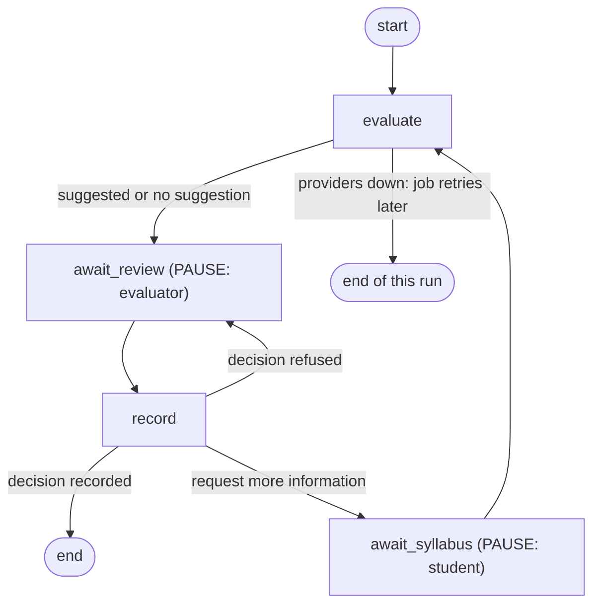

# Per-course workflow (LangGraph) and the human review pause

Code: [`app/workflows/`](../app/workflows/). Tests: [`tests/test_workflow_interrupt.py`](../tests/test_workflow_interrupt.py) (17 cases).

## Why a workflow engine

A course can wait days for an evaluator, and sometimes loops back to the student. That needs three things a plain request handler does not give:

1. **A real pause.** The workflow stops and saves where it is. No process, thread or timer is held open while a person thinks.
2. **A durable one.** The saved state lives in PostgreSQL, so a restart or redeploy loses nothing.
3. **Explicit steps.** Where the AI may act, where a human must act, and what happens when a decision is refused are drawn in one place, not scattered across endpoints.

## The graph



| Step | Does | Who or what |
|---|---|---|
| `evaluate` | Reads the syllabus, finds candidates, asks the LLM gateway, saves a **suggestion** | Worker (AI) |
| `await_review` | **Pauses** until an evaluator submits a decision | Human |
| `record` | Checks the rules again, writes the decision, status change and audit row | Code |
| `await_syllabus` | **Pauses** until the student uploads a new syllabus | Human |

## Where the work happens

- **Worker** (`workers/evaluation_worker.py`): an `evaluate_course` job runs the graph. It stops at `await_review`. If a course is waiting at `await_syllabus`, the job resumes that same workflow, so a second round of AI evaluation continues the first.
- **Decision endpoint** (`POST /api/transcript-courses/{id}/decision`): locks the course row, checks the request, then resumes the paused workflow with the decision. The `record` step checks everything again before it writes.
- **Status endpoint** (`GET /api/transcript-courses/{id}/workflow`, evaluators only): `waiting_for_evaluator`, `waiting_for_student`, `waiting_for_ai`, `finished`, `idle` or `not_started`, with the round count and checkpoint id.

## What is stored where

| Storage | Holds | Role |
|---|---|---|
| Our tables (`transcript_courses`, `evaluations`, `evaluation_decisions`, `status_history`, `audit_logs`) | Everything that is true: statuses, suggestions, decisions, reasons | **System of record** |
| LangGraph checkpoint tables (`checkpoints`, `checkpoint_blobs`, `checkpoint_writes`, `checkpoint_migrations`) | Which step each course is at, the round count, the submitted decision | Flow control only |

The checkpoint holds plain values: a course id, a round count, the decision payload. It never holds a database session, student text or a syllabus.

## Guarantees, and the test that proves each

| Guarantee | Test |
|---|---|
| The AI step ends at a human pause and decides nothing | `test_the_ai_step_ends_at_a_human_pause_and_nothing_is_decided` |
| Nothing runs while paused; a duplicate job cannot restart it | `test_nothing_runs_while_paused_and_a_duplicate_job_cannot_restart_it` |
| The pause survives a restart | `test_the_pause_survives_a_restart` (and a live run against Azure PostgreSQL across processes) |
| A refused decision leaves the course paused for a corrected one | `test_a_refused_decision_leaves_the_workflow_paused` |
| The `record` step rechecks the rules even if the endpoint check is bypassed | `test_the_record_step_rechecks_the_rules_even_if_the_endpoint_check_is_skipped` |
| "Request more information" loops through the student and back to the evaluator, keeping both decisions | `test_request_more_information_loops_through_the_student` |
| An AI outage waits for the AI, not the human, and recovers | `test_when_no_ai_is_available_the_workflow_waits_for_the_ai_not_the_human` |
| The AI step cannot run from the API | `test_the_graph_cannot_run_the_ai_step_outside_the_worker` |
| Only plain flow state is checkpointed | `test_the_checkpoint_holds_flow_state_only` |

## Operating it

```bash
python -m app.workflows.backfill     # save a workflow for any waiting course that has none
python -m app.db.seed_demo --reset   # demo data; each waiting course starts paused at human review
```

- The first use creates the checkpoint tables in the database (`PostgresSaver.setup()`).
- A course with no saved workflow (data from before this existed) is still decided, with exactly the same checks. `backfill` brings it into the workflow.
- `seed_demo --reset` also clears saved workflows, because they belong to the courses it deletes.
- Tests use an in-memory checkpointer, so they never write to the real database.

## Limits

- **Timeouts and reminders.** A paused course waits forever. There is no escalation if an evaluator never responds. Add a scheduled check on `waiting_for_evaluator` older than N days.
- **Reassignment.** Any evaluator can decide any waiting course. Department routing and assignment are not modelled.
- **Superseding a decision.** After `finished`, a course cannot be re-opened through the workflow. Decisions are immutable by design; a correction process would need its own step.
- **Thread per course.** The thread id is the course id. If a course were ever deleted and recreated with the same id, stale state could resume. Courses use fresh UUIDs, so this does not happen in practice.
- **Version drift.** Changing the graph shape while courses are paused needs care (a paused course keeps the shape it was saved with). Add nodes at the end of a path, or migrate paused courses first.
- **Package pin.** Built on LangGraph 1.2.x. The `interrupt` and checkpointer APIs changed between 0.2 and 1.x; keep `requirements.txt` pinned to a tested range.
